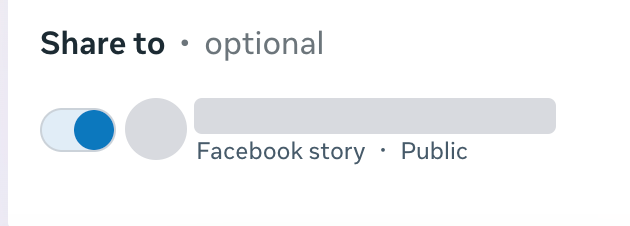
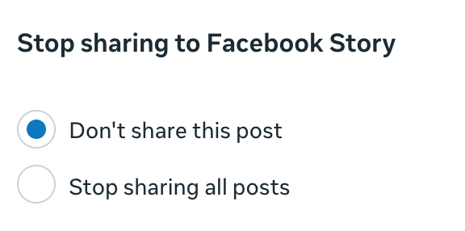
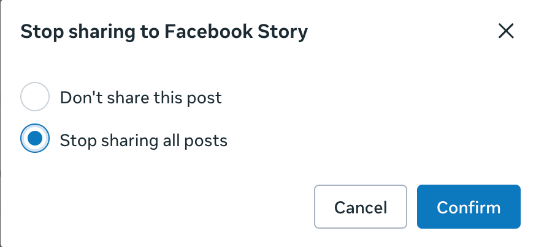
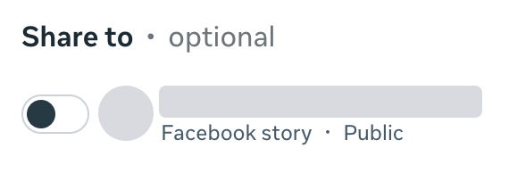

# Stories

PostStack can publish Stories in two ways:

- **Story format**: a post whose format is Story is published as a Story on Facebook (photo and video) and Instagram.
- **Auto-Story (PRO)**: after a feed post is published, PostStack publishes a Story about it. Turn it on per channel in **Channels → (channel) → Auto-Story** and override it per post in the composer or via the API (`autoStory`, `autoStoryMode`; channel `default_auto_story`, `default_auto_story_mode`). The Story mode decides what the Story contains:
  - `card`: a generated card (for a video post it uses a frame from the video as its picture);
  - `media`: the post's own photo or video re-published as a Story (for a carousel, the first item). Video must fit the Story limits (Facebook up to 90 s, Instagram up to 60 s); otherwise PostStack falls back to the card and records the reason.

## Facebook adds a shortened reel preview to your Story

### Symptom

After a reel is published to a Facebook Page (from PostStack, the API or anywhere else), a Story appears on the Page that PostStack did not send: a short fragment of the reel with a **Watch video** button. Viewers see it as a cut-off reel.

### Cause

This is a Page setting in Meta Business Suite, not something PostStack does. When it is on, Facebook itself shares every new reel of the Page to the Page's Story as a preview. The setting is remembered per Page; on a Page we checked it was on by default, on another it was off.

The Graph API cannot read or change this setting: the reel publishing endpoint (`/{page-id}/video_reels`) has no Story parameter, and `GET /{page-id}/settings` does not include it. PostStack therefore cannot detect it or turn it off for you.

### Check and turn it off

We found this setting only in the Business Suite reel composer. We could not find an official Meta help page that documents it or another place to change it.

1. Open the Page's reel composer in Meta Business Suite:
   `https://business.facebook.com/latest/reels_composer/?asset_id=<FACEBOOK_PAGE_ID>`
   (replace `<FACEBOOK_PAGE_ID>` with the Page's numeric ID). In PostStack, the Facebook channel's **Auto-Story** panel links straight to this page for that channel.
2. Add any video. The composer only shows the next steps once a video is added. You do not have to publish it.
3. Go to the **Share** step. Under **Share to · optional** you see the Page with **Facebook story · Public** and a switch. If the switch is on, Facebook shares your reels to Story.

   

4. Turn the switch off. The **Stop sharing to Facebook Story** dialog opens with **Don't share this post** selected; that would only apply to the reel in the composer.

   

5. Select **Stop sharing all posts** and click **Confirm**.

   

6. The switch is now off. Leave the composer without publishing; the choice is saved for the Page.

   

After this change, a reel published through the API did not get a Story preview on the Page we tested.

### Want the full reel in your Story?

Use PostStack's auto-Story in `media` mode (PRO): it publishes the reel's whole video as a Story, within the Story limits (Facebook up to 90 s, Instagram up to 60 s). Longer videos fall back to the generated card.
